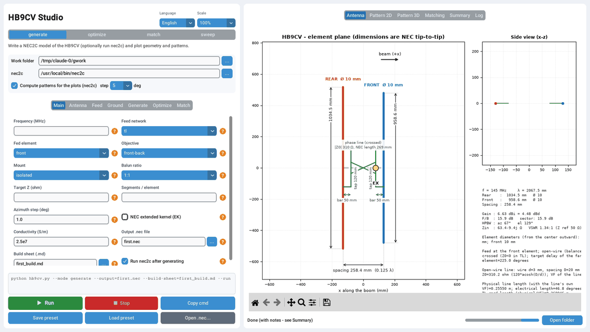
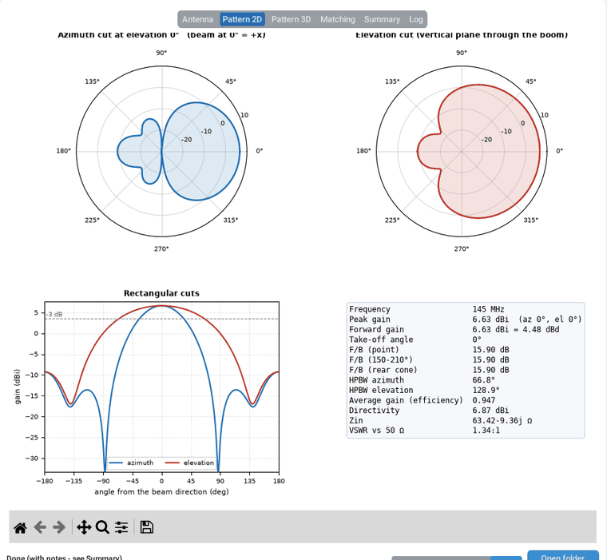
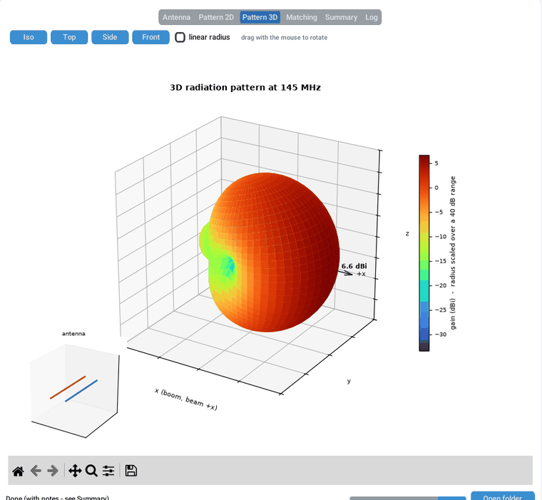
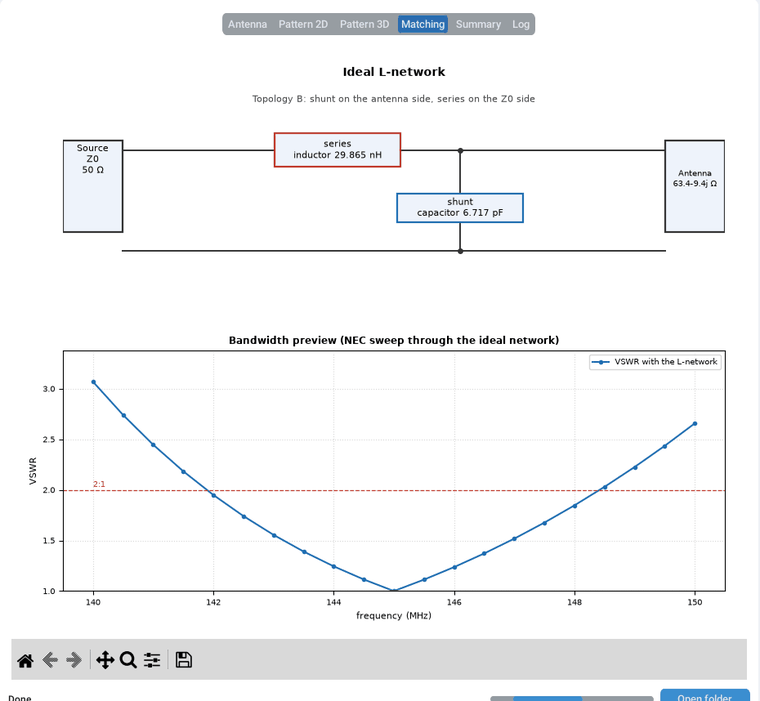

# HB9CV Studio

[](LICENSE)

**Design, simulate, optimize and match a two-element HB9CV beam antenna with NEC-2 (nec2c).**

HB9CV Studio is a Python toolkit for radio amateurs and antenna builders. It writes NEC-2 models of the classic
HB9CV (two driven elements fed through a crossed phasing line), runs them through
**nec2c** (a C port of NEC-2), and turns the results into the numbers and drawings you need
to build the antenna: gain, front-to-back ratio, beamwidth, input impedance, VSWR, matching network and a
complete build sheet.

Author: **Emiliano Gonzalez - LU3VEA**

It comes in two parts:

| File | What it is |
|---|---|
| `hb9cv.py` | The engine: a command-line tool with four modes (`generate`, `optimize`, `match`, `sweep`). |
| `hb9cv_gui.py` | **HB9CV Studio**, a graphical front end that exposes every option, shows the command it runs, and plots the results. |



---

## Features

**Modelling**
- Classic HB9CV with an open-wire or coax phasing line (`tl`), a lumped LC network (`lc`), or an ideal
  current/voltage drive as a theoretical reference (`ideal`).
- T-match or centre feed, isolated elements or element centres bonded to a metal boom (`--mount contact`).
- Stepped (telescopic) tubes, separate rear/front diameters, conductor losses (`LD 5`).
- Up to 2 extra reflectors and 5 directors.
- Free space or real ground (average, good, perfect or custom εr/σ), horizontal or vertical polarization, and an
  optional metal mast.
- Phasing line synthesized from the actual two-port response of the elements, not just the textbook
  180° − kd rule.

**Analysis**
- Gain in dBi and dBd, realized gain, take-off angle, and azimuth/elevation half-power beamwidth.
- Front-to-back ratio in three variants: point (180°), rear sector (default 150–210°), and rear cone at any
  elevation.
- Input impedance, VSWR, and 2:1 bandwidth from a frequency sweep.
- Quality checks: average-gain test, NEC power-budget check (unphysical runs are rejected), segmentation
  convergence, wire-clearance check, and thin-wire rule warnings.
- Sensitivity studies: metal boom, mast, mast length, height sweep, and common-mode current on the feed line.

**Optimization**
- Grid search, then local refinement, then a Nelder–Mead polish over spacing, element lengths, line length and
  Z0, T-match taps, tube diameter and parasitic elements.
- Objectives: `front-back`, `gain` or `balance`, scored at the worst frequency of a band.
- Optional scoring through an L-network built from components with finite Q.
- An impedance window for Rin and |Xin|. If no candidate meets it, the closest one is still written.
- Monte-Carlo tolerance analysis that re-ranks candidates by their 10th-percentile score, to favour designs that
  are robust to build errors.

**Matching**
- Ideal L-network (both low-pass and high-pass solutions) for any NEC result or a typed R + jX.
- Component losses from Q, capacitor ESL and coil stray capacitance.
- Bandwidth sweep with commercial (E-series) values and worst-case component tolerances.

**Output**
- A `.nec` deck, the nec2c `.out` result, and a JSON summary of the main results.
- A Markdown/JSON **build sheet**: cut lengths, spacing, boom, phasing line, T-match and a tuning procedure.
- A CSV of every optimizer candidate and CSVs of frequency and matching sweeps.

**GUI**
- Every command-line option is available in seven tabs, each with a full help panel.
- Options that the selected mode does not use are greyed out.
- Live command preview and log, a Stop button, and presets.
- Antenna drawing to scale, polar and rectangular pattern cuts, and an interactive 3D pattern.
- L-network schematic, plus VSWR and impedance plots.
- English, Spanish and Italian interface; scales for high-DPI screens (Ctrl + / Ctrl − / Ctrl 0).

| Radiation pattern | 3D pattern |
|---|---|
|  |  |

| L-network matching | Optimized design |
|---|---|
|  |  |

---

## Requirements

| | Linux (Fedora, Debian, Ubuntu, Linux Mint) | Windows 10 / 11 |
|---|---|---|
| Python | 3.9 or newer with Tk and venv (distribution packages) | 3.9 or newer from python.org (includes Tk) |
| Python packages | `customtkinter`, `matplotlib`, `numpy` (installed in a virtual environment) | same |
| nec2c | distribution package `nec2c`, or compiled from source | compiled from source with MSYS2, or an existing `nec2c.exe` |

nec2c is needed for simulation, optimization and the pattern plots. Without it you can still write models and design
matching networks from typed impedances. The engine `hb9cv.py` only uses the Python standard library; the three
packages are for the GUI.

The installers below do everything for you. The manual steps are listed after each installer for reference.

## Installation on Linux

Tested distributions: **Fedora**, **Debian**, **Ubuntu** and **Linux Mint** (and their derivatives).

### With the installer (recommended)

```bash
git clone https://github.com/<user>/<repo>.git hb9cv-studio
cd hb9cv-studio
./install.sh
```

Run `install.sh` as your normal user, not with `sudo`. It calls `sudo` itself for the system packages, so it may ask for your
password. The installer:

1. installs the system packages:
   - Fedora: `sudo dnf install python3 python3-pip python3-tkinter nec2c`
   - Debian / Ubuntu / Mint: `sudo apt install python3 python3-venv python3-pip python3-tk nec2c`
2. if the distribution has no `nec2c` package, compiles it from source (`tools/build_nec2c.sh`, which needs `gcc`);
3. copies the program to `~/.local/share/hb9cv-studio`;
4. creates a virtual environment there with `customtkinter`, `matplotlib` and `numpy`;
5. creates the commands `hb9cv-studio` (GUI) and `hb9cv` (command line) in `~/.local/bin`;
6. adds **HB9CV Studio** with its icon to the applications menu.

| Option | Effect |
|---|---|
| `--prefix DIR` | install somewhere else |
| `--no-system-deps` | skip dnf/apt (install Python, Tk and nec2c yourself) |
| `--build-nec2c` / `--no-build-nec2c` | always / never compile nec2c from source |
| `--no-desktop` | no menu entry |
| `-y` | do not ask questions |

Start the program from the applications menu, or from a terminal:

```bash
hb9cv-studio                 # graphical interface
hb9cv --help                 # command line
```

If the shell says `hb9cv-studio: command not found`, log out and back in once. Most distributions add `~/.local/bin` to
the `PATH` at login once the folder exists. Alternatively run `~/.local/bin/hb9cv-studio`.

- **Update:** `git pull`, then `./install.sh` again (your settings are kept).
- **Uninstall:** `./uninstall.sh` (add `--purge` to also remove the settings file `~/.hb9cv_gui.json`).
  System packages are left installed.

### Manually

```bash
# Fedora
sudo dnf install python3 python3-pip python3-tkinter nec2c
# Debian / Ubuntu / Linux Mint
sudo apt install python3 python3-venv python3-pip python3-tk nec2c

cd hb9cv-studio
python3 -m venv .venv
.venv/bin/pip install -r requirements.txt
.venv/bin/python hb9cv_gui.py          # GUI
.venv/bin/python hb9cv.py --help       # command line
```

If your distribution has no `nec2c` package, `tools/build_nec2c.sh` compiles it into `bin/` next to the program, where
it is found automatically.

## Installation on Windows

### With the installer (recommended)

1. Download the project: **Code → Download ZIP** on GitHub. Extract it, for example to `Downloads\hb9cv-studio`.
2. Double-click **`install.bat`**. If Windows SmartScreen warns you, choose *More info → Run anyway*.
3. Answer the questions. The installer works for your user only and needs no administrator rights. It:
   - looks for Python 3.9+ with Tk. If there is none, it offers to install Python 3.12 with `winget`;
   - copies the program to `%LOCALAPPDATA%\Programs\HB9CV-Studio`;
   - creates a virtual environment there with `customtkinter`, `matplotlib` and `numpy`;
   - provides `nec2c.exe` in its `bin` folder. If nec2c is not in the `PATH`, the installer offers to install
     [MSYS2](https://www.msys2.org/) with `winget` (about 500 MB). It then compiles nec2c from source and copies
     `nec2c.exe` with its runtime DLLs. The first MSYS2 run takes several minutes;
   - creates **HB9CV Studio** shortcuts in the Start menu and on the desktop. The Start menu folder also links to
     the three manuals and to the uninstaller.

PowerShell options, for example
`powershell -ExecutionPolicy Bypass -File install.ps1 -AddToPath -Yes`:

| Option | Effect |
|---|---|
| `-InstallDir DIR` | install somewhere else |
| `-Nec2c C:\path\nec2c.exe` | use an existing nec2c.exe (MSYS2/Cygwin DLLs next to it are copied too) |
| `-SkipNec2c` | do not look for or compile nec2c |
| `-AddToPath` | add the program folder to your `PATH`, so `hb9cv` and `hb9cv-studio` work in any terminal |
| `-NoShortcuts` | no Start menu or desktop shortcuts |
| `-Yes` | do not ask questions |

Start the program from the Start menu or the desktop. The command line is `hb9cv.cmd` in the program folder
(or just `hb9cv` with `-AddToPath`):

```bat
hb9cv --help
hb9cv --mode generate --run -o first.nec
```

- **Update:** download the new version and run `install.bat` again.
- **Uninstall:** use *Start menu → HB9CV Studio → Uninstall HB9CV Studio*, or run `uninstall.bat` (add `-Purge` to
  also remove the settings file). Python and MSYS2 are left installed; remove them from *Settings → Apps* if you no
  longer need them.

### Manually

1. Install Python 3 from <https://www.python.org/downloads/>. Tick **Add python.exe to PATH** and keep
   **tcl/tk and IDLE** selected.
2. Get `nec2c.exe`:
   - install MSYS2;
   - in the *MSYS2 MSYS* terminal, go to the project folder and run
     `pacman -S --needed gcc tar curl git` and then `bash tools/build_nec2c.sh bin`;
   - this puts `nec2c.exe` and its DLLs in `bin\`, where the program finds them.
3. In a terminal opened in the project folder:

```bat
py -m venv .venv
.venv\Scripts\pip install -r requirements.txt
.venv\Scripts\pythonw hb9cv_gui.py
.venv\Scripts\python hb9cv.py --help
```

**Alternative: WSL.** On Windows 11 you can also use the Linux installation inside WSL (Ubuntu) with
`wsl --install`. The GUI opens as a normal window through WSLg.

### Where the program looks for nec2c

1. the `nec2c` field of the GUI, or `--nec2c PATH` (a file, or a folder containing `nec2c` / `nec2c.exe`);
2. the `HB9CV_NEC2C` environment variable;
3. the `PATH`;
4. the `bin` folder next to `hb9cv.py` (where the installers and `tools/build_nec2c.sh` put it).

Keep `hb9cv.py` and `hb9cv_gui.py` in the same folder.

## Quick start (GUI)

Start **HB9CV Studio** from the menu (or `hb9cv-studio`). To open it with a complete 146 MHz optimization ready to run:

```bash
hb9cv-studio --load-default-example          # Linux, after install.sh
python3 hb9cv_gui.py --load-default-example  # from the source folder
```

1. Choose a **Work folder**; all output files go there.
2. Keep the mode on **generate**, tick **Run nec2c after generating**, and press **Run**.
3. Read the results in the **Antenna**, **Pattern 2D**, **Pattern 3D**, **Summary** and **Log** tabs.

With the defaults this gives a classic 145 MHz HB9CV:

```
Rear 1034.5 mm, front 958.6 mm, spacing 258.4 mm (0.125 λ)
Gain 6.63 dBi (4.48 dBd), F/B 15.9 dB, HPBW 67° (azimuth)
Zin 63.4 − 9.4j Ω, VSWR 1.34:1 vs 50 Ω, 2:1 bandwidth 143.5–149.0 MHz
```

The **Copy cmd** button copies the equivalent command line.

## Command line

```bash
hb9cv --help                 # after the installer (Linux, or Windows with -AddToPath)
python3 hb9cv.py --help      # from the source folder (Windows: py hb9cv.py --help)
```

The examples below use `python3 hb9cv.py`. After installing, `hb9cv` does the same.

| Mode | Purpose |
|---|---|
| `generate` | Write a NEC model of the HB9CV and optionally run nec2c (`--run`). |
| `optimize` | Search the geometry with nec2c and write the best model and its build sheet. |
| `match` | Design an ideal L-network for the NEC input impedance (or `--r`/`--x`) at one frequency. |
| `sweep` | Evaluate that L-network over frequency, with commercial values and tolerances. |

Typical workflow:

```bash
# 1. find a good geometry for the 2 m band
python3 hb9cv.py --mode optimize --freq 146 --band 145,147,3 \
    --spacing-values 0.1,0.125,0.15 --line-offset-values=-10,0,10 \
    --tolerance-mc 100 --tol-top-k 3 --build-sheet hb9cv_build.md -o hb9cv_opt.nec

# 2. simulate a model over frequency (impedance vs f, 2:1 bandwidth)
python3 hb9cv.py --mode generate --fsweep 140,150,0.5 --run -o sweep.nec

# 3. design the matching network at 145 MHz with real component Q
python3 hb9cv.py --mode match --nec-out sweep.out --freq 145 --q-l 150 --q-c 500

# 4. check it over the band with ±5 % parts
python3 hb9cv.py --mode sweep --nec-out sweep.out --design-freq 145 --tol-l 5 --tol-c 5
```

More examples:

```bash
# over average ground at 10 m, horizontal polarization
python3 hb9cv.py --mode generate --ground average --height-m 10 --run -o ground.nec

# HB9CV with one reflector and two directors
python3 hb9cv.py --mode generate --reflectors 1 --directors 2 --run -o yagi.nec

# trust checks: segmentation convergence and robustness (boom, mast, coax without choke)
python3 hb9cv.py --mode generate --robustness --check-convergence -o check.nec
```

> A value that starts with a minus sign must be joined with `=`, for example `--line-offset-values=-10,0,10`.

## Output files

All files are written to the working directory (the GUI's work folder).

| File | Produced by | Content |
|---|---|---|
| `name.nec` | generate, optimize | NEC-2 deck (geometry, excitation, TL/NT, loads, ground, RP cards) |
| `name.out` | `--run`, optimize | nec2c output |
| `name.freqs.json` | `--run`, optimize | exact frequencies of the deck (used by match/sweep) |
| `name_build.md` / `.json` | `--build-sheet` | build sheet: cut lengths, boom, phasing line, T-match, tuning |
| `hb9cv_scan.csv` | optimize (`--csv`) | every candidate with its dimensions and score |
| `lnetwork_sweep.csv` | sweep | VSWR and impedances of the matching network vs frequency |
| `--json-out FILE` | all modes | main results as JSON (read by the GUI) |

## Documentation

Full user manuals with screenshots of every function, written for first-time users:

- 🇬🇧 [English](docs/manual/HB9CV_Studio_User_Manual_EN.pdf)
- 🇪🇸 [Español](docs/manual/HB9CV_Studio_Manual_de_Usuario_ES.pdf)
- 🇮🇹 [Italiano](docs/manual/HB9CV_Studio_Manuale_Utente_IT.pdf)

Each manual covers installation, a tour of the window, a first-antenna tutorial, how to read every result,
parasitic elements, ground, frequency sweeps, the optimizer, matching, the build sheet, quality checks, the command
line, troubleshooting, and a complete reference of every option.

The built-in help (`--help`, and the **?** badge next to each field in the GUI) explains every option in detail.

## Limitations — simulation versus reality

- NEC uses straight thin wires and **ideal** sources and transmission lines. Real clamps, insulators, spacers,
  bends and nearby objects shift resonance and impedance. Treat the results as a design starting point and
  **tune the built antenna with an antenna analyzer or VNA**.
- The NEC source is balanced. A real build **needs a 1:1 current balun or common-mode choke** at the feed point;
  without one the coax shield radiates and the F/B and Zin change. `--feedline-length-m` and `--cm-sensitivity`
  estimate the effect.
- The boom is not modelled by default (insulating boom assumed). Use `--mount contact`, `--boom-isolated` or
  `--robustness` for a metal boom.
- The thin-wire kernel is the default; the extended kernel (`--extended-kernel`) is opt-in. Every run is checked
  against the NEC power budget, and unphysical results are rejected.
- The matching network is a lumped, single-frequency design. Layout parasitics are only approximated (ESL, coil
  stray C).
- The text printed by `hb9cv.py` (log, warnings, build sheet) is in English. The GUI is available in English,
  Spanish and Italian.

## Tests

```bash
python3 -m venv .venv && .venv/bin/pip install -r requirements.txt pytest
.venv/bin/python -m pytest tests
```

Tests marked as needing nec2c are skipped when nec2c is not found.

## Project layout

```
hb9cv.py                  engine (CLI): generate / optimize / match / sweep
hb9cv_gui.py              HB9CV Studio graphical interface
requirements.txt          Python packages (customtkinter, matplotlib, numpy)
install.sh, uninstall.sh  Linux installer / uninstaller (Fedora, Debian, Ubuntu, Mint)
install.bat, install.ps1  Windows installer (install.bat runs install.ps1)
uninstall.bat, uninstall.ps1  Windows uninstaller
tools/build_nec2c.sh      downloads and compiles nec2c (Linux, or MSYS2 on Windows)
assets/                   application icon (PNG, ICO)
tests/test_hb9cv.py       regression tests (pytest)
docs/manual/              user manuals (EN / ES / IT, PDF)
docs/images/              screenshots used in this README
LICENSE                   GNU General Public License v3
```

## Contributing

Bug reports and pull requests are welcome. Please include:
- the exact command (the GUI's **Copy cmd** button gives it);
- the output of the **Log** tab;
- the nec2c version and your operating system (distribution and version, or Windows version).

Run the tests before submitting changes. Contributions are accepted under the same license as the project
(GPL-3.0-or-later).

## Author

**Emiliano Gonzalez - LU3VEA**

## License

Copyright (C) 2026 Emiliano Gonzalez - LU3VEA

This program is free software: you can redistribute it and/or modify it under the terms of the
**GNU General Public License** as published by the Free Software Foundation, either **version 3** of the License,
or (at your option) any later version.

This program is distributed in the hope that it will be useful, but WITHOUT ANY WARRANTY; without even the
implied warranty of MERCHANTABILITY or FITNESS FOR A PARTICULAR PURPOSE. See the [LICENSE](LICENSE) file or
<https://www.gnu.org/licenses/> for details.

The user manuals in `docs/manual/` are distributed under the same license.

---

*73 and good building! — LU3VEA*
